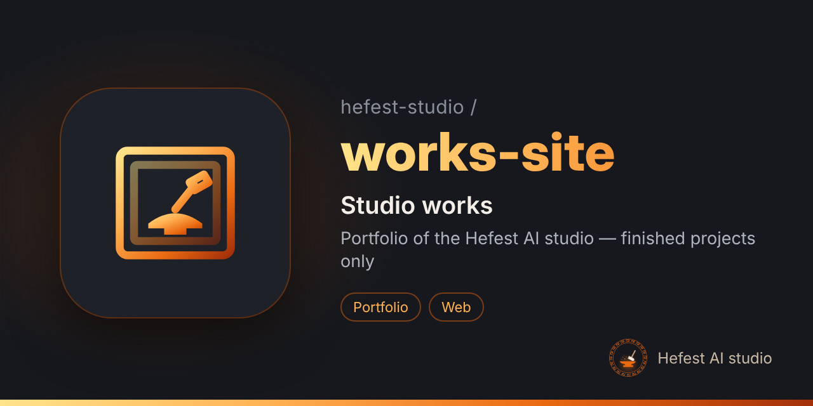

**English** | [Русский](README.ru.md)

# works-site — the Hefest studio portfolio

A public one-page portfolio in Russian and English: `works.hefest.ru` opens in Russian, `works.hefest.online`
in English; the RU / EN switch on the page and `?lang=ru|en` override that, and the choice is remembered.
Static files, deployed to Vercel (automatic HTTPS). A work of the Hefest studio. What is next — [roadmap](ROADMAP.md).

## Contents
- `index.html` — the showcase: cards of the studio's works (Polyinstrumental Workshop, Retro Games, Tab Forge) and an "Examples" section.
- `examples/` — curated public example deliverables (from the reports project; personal items excluded).

## Deploy
Vercel → project `works-site` → domains `works.hefest.ru` + `works.hefest.online`.
The work cards link to the subdomains `workshop.hefest.ru` (music-book) and `arcade.hefest.ru` (retro-games); Tab Forge links to its repository / store.

## Privacy
A static showcase that collects no personal data. If a request form is ever added, personal data of Russian
citizens must go to an endpoint in Russia (not to Vercel).
