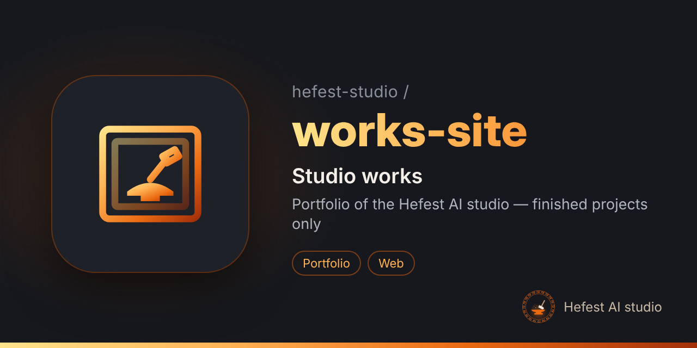

[English](README.md) | **Русский**

# works-site — витрина работ студии «Гефест»

Публичный одностраничник-портфолио на русском и английском: `works.hefest.ru` открывается по-русски, `works.hefest.online` — по-английски; переключатель RU / EN на странице и `?lang=ru|en` важнее домена, выбор запоминается. Что дальше — [роадмап](ROADMAP.ru.md).
Статика, деплой на Vercel (авто-HTTPS). Работа студии «Гефест».

## Содержимое
- `index.html` — витрина: карточки работ (Полиинструментальный цех, Зал ретро-игр, Кузня вкладок) + раздел «Примеры».
- `examples/` — курированные публичные примеры-деливераблы (из проекта reports; личное исключено).

## Деплой
Vercel → проект `works-site` → домены `works.hefest.ru` + `works.hefest.online`.
Карточки работ ведут на поддомены `workshop.hefest.ru` (music-book) и `arcade.hefest.ru` (retro-games); Кузня вкладок — на репозиторий/стор.

## Приватность / 152-ФЗ
Статическая витрина без сбора ПДн. Если добавится форма заявок — приём ПДн граждан РФ направлять на РФ-эндпоинт (не на Vercel). См. core/docs/BUSINESS/renewals.md, studio-works.md.
